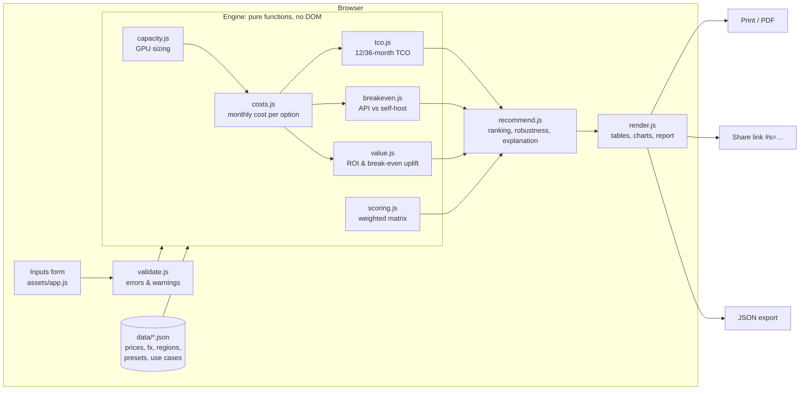

# AI Stack Advisor

**Build or buy your AI solution?** A free, browser-only consulting tool that compares SaaS, API-based, self-hosted and hybrid AI stacks on monthly cost, 36-month total cost of ownership, break-even volume and ROI, then writes a consultant-style recommendation.

**Live demo:** https://kaunteyacharya.github.io/ai-stack-advisor/

[](https://github.com/KaunteyAcharya/ai-stack-advisor/actions/workflows/test-and-deploy.yml)


<!-- Screenshot placeholder: add docs/screenshot.png -->

## The problem it solves

A business that wants an AI chatbot, voice agent or document assistant faces a build-vs-buy decision with real money at stake. Should it subscribe to a SaaS tool, build on hosted LLM APIs, run an open model on its own GPUs, or mix the two? The answer depends on volume, data sensitivity, team skills and what each customer conversation is worth.

AI Stack Advisor turns those inputs into numbers and a clear recommendation, listing every assumption behind it. It is aimed at founders, operations leads and consultants scoping an AI project, in India, the US, Canada, Australia, the UAE, the UK, Switzerland and the Eurozone.

## Features

- **Four options compared:** SaaS (per seat, per conversation or per resolution), API-based build, self-hosted open model on rented GPUs, and hybrid.
- **Monthly cost and TCO:** 12- and 36-month totals with monthly volume growth; GPU count steps up as traffic grows.
- **Break-even:** the request volume where self-hosting becomes cheaper than APIs, plus a cost-vs-volume chart (log scale) with crossover markers.
- **Value and ROI:** value per conversation, AI cost as a share of ticket size, "pays for itself with N extra sales a month", support savings, and ROI and payback tables by conversion uplift and deflection rate.
- **Decision matrix:** privacy, time to launch, team fit, quality, lock-in and scalability, with adjustable weights and a robustness check ("Robust" or "Close call, decided by X").
- **Tax-aware:** VAT, GST, HST, QST, PST and US sales tax per country (and per province for Canada). Taxes a registered business can reclaim aren't added to cost; taxes it can't reclaim (or any tax, for an exempt business) are added to vendor spend.
- **Realistic assumptions:** growth stops after a set number of months (TCO-36 with no growth is shown too), support savings count only conversations that reach a person today, and the hybrid split is chosen automatically to minimise 36-month cost.
- **Compliance-aware:** options that would send data outside the company are excluded when data must stay in-house; the report names the data-protection law to review (DPDP, GDPR, UK GDPR, FADP, PIPEDA, Privacy Act, PDPL…).
- **Work in your own currency:** choose your country and currency first (guessed from the browser language, no network call). Every amount you enter, every result and the report use it. Supported: INR (lakh/crore), USD, EUR, GBP, CHF, CAD, AUD and AED, with locale-correct formatting and an optional second currency.
- **Several workloads, one stack or a mix:** pick as many goals as you need (e.g. a chatbot, a data assistant and an invoice agent). Every combination is evaluated for up to five workloads, and a local search handles more, with shared infrastructure, pooled GPUs and per-stack effort, and the report compares the best single stack with the best mix.
- **Internal tools valued on staff time:** data assistants and internal copilots are valued on minutes saved per request, not sales.
- **Workflow agents:** invoice processing, lead qualification, report generation, ticket triage, stock data → report, and an end-to-end content engine (AI video, images, posting and replies on your own posts). Priced per task with growing context per step and batch API prices, and valued on time saved in hours or FTEs, after review time and errors.
- **Assumption register:** every number behind a result has a source, a last-reviewed date and a confidence level (verified / benchmark / estimate), shown next to inputs and listed in the report, with the high-impact estimates flagged as "check these first".
- **Labour costs from official statistics:** BLS, Eurostat, ONS, Statistics Canada, ABS, the Swiss FSO and India's PLFS, loaded with documented employer on-costs.
- **How sure is this?** 300 seeded simulations vary prices, GPU throughput, labour, the open-model quality gap and your uncertain inputs, then report how often each option wins and the 10th–90th percentile of costs and net benefit. A tornado chart shows which assumptions move the answer most.
- **Rigorous cost model:** prompt caching at published cached-input prices (only above the provider's minimum prompt size), evaluation hours before launch, present value of 36-month costs, and a quality-adjusted "decision cost" that counts the value open models give up by completing fewer tasks.
- **Executive or analyst view:** a short report (summary, costs, value, one chart) or the full analysis (both charts, decision matrix, sensitivity tables, workings, assumptions), with a section strip that stays at the top. The PDF prints the current view.
- **"Not sure?" ranges:** mark uncertain inputs (volume, growth, completion rate, minutes saved, conversion…) and the summary shows results at the low and high end, for example "saves 64–250 hours/month, payback 0.3–1.3 months", and whether the recommendation changes.
- **Start from goals:** "What do you want AI to do?" cards (answer customers, process invoices, find answers in company data…). Each card you pick becomes a workload.
- **Plain language as you type:** live hints translate inputs ("≈ 2,00,040 requests a month", "≈ 1,100 words", "1,600 of 2,000 invoices done without a person"), and ⓘ buttons explain jargon such as tokens, TCO, RAG, batch and FTE.
- **The answer stays in view:** a result bar shows the recommendation and monthly cost while you edit, and flags each change ("▼ $255/mo", "Recommendation changed").
- **Quick mode:** six questions (industry, use case, users per day, can data leave the company, engineers, DevOps) give a first answer; switch to "All inputs" to fine-tune about 40 fields.
- **Show the workings:** click any monthly cost to see each line as quantity × rate, for example "200,040 requests × $0.00145"; hover for a one-line summary.
- **Compare scenarios:** save up to four scenarios ("today", "after growth", "EU team"…) and compare recommendation, monthly cost, TCO, break-even and payback side by side in the current currency.
- **SaaS billing:** annual or monthly seat prices, using the vendor's listed annual price where there is one.
- **Report and sharing:** print to a clean PDF report, share a scenario as a link (stored in the URL, no server), or download inputs and results as JSON.
- **Industry presets:** D2C e-commerce, B2B SaaS, real estate, healthcare clinic, ed-tech and professional services.

## Architecture



The engine (`engine/`) has no DOM access, so the same code runs in the browser and in Node tests. No build step, no framework: plain HTML, CSS and JavaScript modules. The only runtime library is Chart.js, stored in `assets/vendor/` with its license.

## How the method works

1. **Volume** comes from users per day × requests per user × 30, or from documents × pages for document processing, and grows monthly.
2. **API cost** = tokens × published per-token price, plus database, hosting, vector database, voice and maintenance.
3. **Self-hosting** chooses a model size for the quality need, then the cheapest GPU with enough memory, and sizes the GPU count for peak traffic (30% headroom, 2 minimum for high availability). GPUs run 730 hours a month.
4. **SaaS** uses the cheapest plan whose limits fit the volume, including required seats.
5. **Value** uses gross profit on the first sale for the headline break-even (conservative), plus a 12-month figure for repeat buyers.
6. **Recommendation** = 50% cost score + 50% weighted non-cost score (cost weighs 25% for high-ticket businesses). The explanation is built from fixed templates.

Every formula is written out in **[docs/METHODOLOGY.md](docs/METHODOLOGY.md)**. The inputs object is documented in [docs/inputs.schema.json](docs/inputs.schema.json).

## Privacy

Everything runs in your browser. There is no backend, no API key, no LLM call, no analytics, no cookies and no tracking. A Content Security Policy only allows the page to load files from its own site. Shared links carry the inputs inside the URL itself.

## Pricing data policy

- Every price in [`data/prices.json`](data/prices.json) records its **official source URL** and **last-verified date**.
- Values that could not be verified are marked `is_sample: true`, and the app shows a banner whenever one affects a result.
- GPU throughput figures are labelled **assumptions**, not prices.
- A weekly workflow ([price-check.yml](.github/workflows/price-check.yml)) opens or updates an issue, "Price data needs verification", listing entries older than 30 days or marked as samples.

## Multi-currency support

| Region | Currency | Format |
|---|---|---|
| India | INR | ₹65,00,000 · ₹65 lakh · ₹1.4 crore |
| United States | USD | $1,234,567.89 |
| Canada | CAD | en-CA |
| Australia | AUD | en-AU |
| United Arab Emirates | AED | en-AE |
| United Kingdom | GBP | £1,234,567.89 |
| Switzerland | CHF | de-CH |
| Eurozone: DE, NL, IE, FR, BE, AT, FI, LU | EUR | each country's own locale (e.g. 1.234.567,89 € or €1,234,567.89) |

Everything is calculated in USD and converted for display using the **European Central Bank reference rates**, which a weekly workflow ([fx-update.yml](.github/workflows/fx-update.yml)) refreshes **through a pull request** for review. The update is rejected if any rate moved more than 15%. The ECB does not publish AED, so AED uses its fixed peg of 3.6725 per USD. Adding a country is a data change in `data/regions.json`.

## Run locally

```bash
python -m http.server 8000
```

Then open http://localhost:8000. Any static server works; opening `index.html` directly from disk does not, because browsers block ES modules on `file://`.

```bash
npm test                 # unit + end-to-end scenario tests (Node's built-in test runner, no dependencies)
npm run check-prices     # list prices older than 30 days or marked as samples
npm run fx-update        # fetch the latest ECB rates into data/fx.json
npm run docs:scoring     # regenerate the scoring tables in docs/METHODOLOGY.md
npm run count-tokens     # count tokens in data/samples (set GEMINI_API_KEY to measure with Google instead of estimating)
```

## Limitations

- Estimates for planning only; vendor prices change often, and volume customers negotiate.
- GPU throughput, model memory needs, engineer costs and build or maintenance hours are assumptions; edit them to match your situation.
- Open-weight model quality varies by task and may trail frontier models; test on your own data.
- Data-protection notes name laws to review with a legal advisor; they are not legal advice. Tax treatment is simplified (no withholding tax, partial exemption or place-of-supply edge cases); review with a tax advisor.

## Creator

Built by **Kauntey Acharya** as a portfolio project demonstrating AI consulting judgment: build vs buy, TCO and ROI.

- Portfolio: https://kaunteyacharya.github.io
- GitHub: https://github.com/KaunteyAcharya
- LinkedIn: https://www.linkedin.com/in/kauntey-acharya

## License

[MIT](LICENSE). Chart.js is MIT-licensed ([assets/vendor/CHART-LICENSE.txt](assets/vendor/CHART-LICENSE.txt)).
